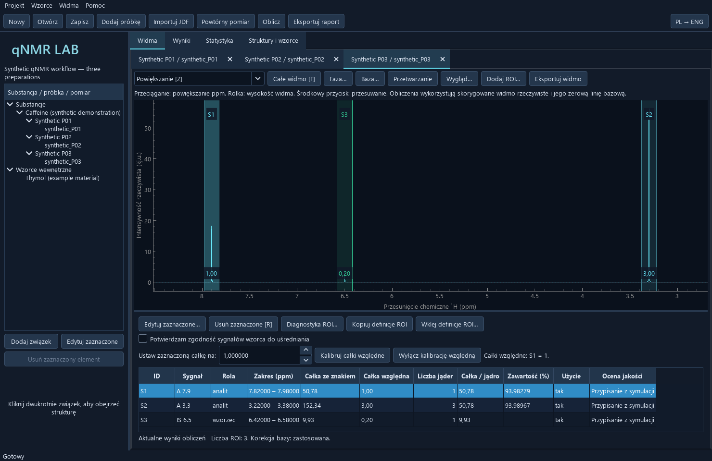
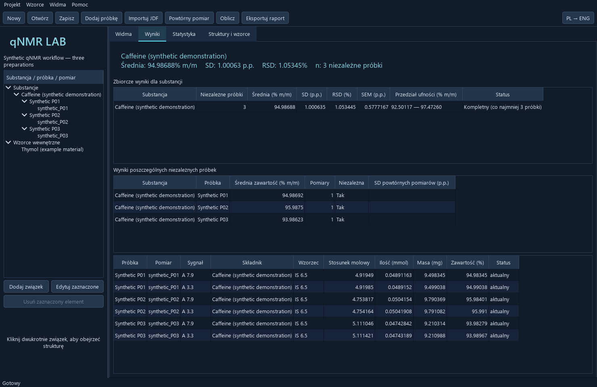
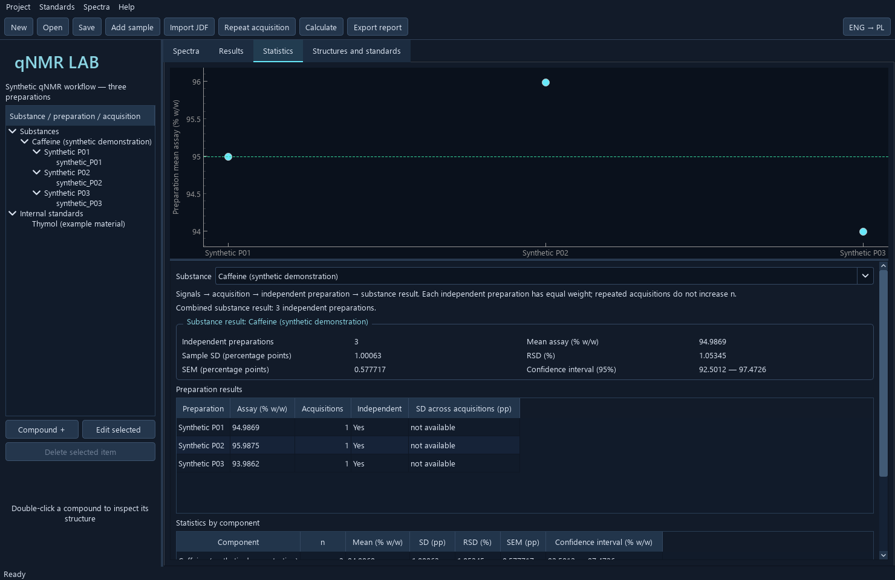

# qNMR Lab 1.0.1

Aktualne wydanie **1.0.1** zawiera przeprojektowany generator raportów
naukowych i opcjonalny profil techniczny. Paczka deploymentowa, kod w repozytorium
i wersja aplikacji są zgodne. Uruchom aplikację plikiem **Start_qNMR_Lab.bat**.
Opis: [Raporty PL](docs/REPORTS_PL.md) · [Reports ENG](docs/REPORTS_EN.md).

[English](README_EN.md) · [Pobierz aktualne wydanie 1.0.1](https://github.com/Prospero1988/qNMR_Lab/releases/latest) · [MIT](LICENSE)

Aplikacja Windows do ilościowej analizy protonowego NMR ze wzorcem wewnętrznym.
Od surowego FID JEOL przez przetwarzanie i całkowanie po wynik substancji,
statystykę niezależnych próbek i raport. Polski jest językiem domyślnym;
przycisk **PL → ENG** przełącza cały interfejs i język raportów.



## Uruchomienie

1. Pobierz i rozpakuj **cały** plik `qNMR_Lab_1.0.1_PL_EN_deployment.rar` z [aktualnego wydania 1.0.1](https://github.com/Prospero1988/qNMR_Lab/releases/latest).
2. Uruchom **Start_qNMR_Lab.bat** z rozpakowanego folderu.
3. Pierwszy start przygotuje środowisko i pobierze przypięte biblioteki.

Wymagania: **Windows x64, Python 3.12 x64 oraz Internet przy pierwszym uruchomieniu**.
Kolejne uruchomienia korzystają z gotowego środowiska. DOSY Lab nie jest potrzebny.
Możesz też sklonować repozytorium i uruchomić ten sam plik BAT.

```powershell
git clone https://github.com/Prospero1988/qNMR_Lab.git
cd qNMR_Lab
.\Start_qNMR_Lab.bat
```

## Możliwości

- Import konwencjonalnych, zespolonych **JEOL JDF 1D ¹H**; FFT, apodyzacja,
  dopełnienie zerami i przetwarzanie z podglądem na żywo.
- Interaktywna faza, zaznaczanie obszarów bazy, korekcja linii bazowej
  i ustawianie wzorca ppm kliknięciem.
- Ilościowe ROI, stałe identyfikatory S1/S2/…, całki ze znakiem i kalibracja
  względna; wartości widoczne z dwoma miejscami po przecinku.
- SMILES, MOL/SDF, struktury z numerami atomów, masy molowe i biblioteka wzorców.
- Kopiowanie ROI i ustawień pierwszego pomiaru próbki; zmiana granic, podział,
  wykluczanie i usuwanie sygnałów oraz elementów projektu.
- Kolor i grubość widma, siatka, eksport PNG i CSV.
- Raporty **DOCX, XLSX, CSV** oraz komplet danych z identyfikowalnością.
  Raport DOCX ma naukowy układ A4, czytelne tabele, struktury i wykresy;
  opcjonalny profil techniczny zawiera szczegółową diagnostykę.

## Substancja → próbka → pomiar

Dla jednego związku dodaj co najmniej trzy niezależnie przygotowane próbki.
Powtórny pomiar tego samego roztworu dodaj do tej samej próbki.
Program uśrednia sygnały w pomiarze, pomiary w próbce, a następnie średnie
niezależnych próbek. Każda próbka ma równą wagę: 2, 1 i 3 pomiary trzech
próbek nadal dają **n = 3**. Wyniki różnych substancji są prezentowane osobno.



Statystyka obejmuje średnią, SD próby, RSD, SEM i przedział ufności Studenta.
Status kompletny wymaga co najmniej trzech niezależnych próbek z aktualnymi
wynikami. Zmiana danych zachowuje wcześniejsze wyniki jako historyczne do
ponownego obliczenia. Zaokrąglenie widoku nie zmienia dokładności obliczeń.



## Projekty i raporty

Jeden plik **.qnmr** zawiera FID, widma przetworzone, parametry, ROI, przypisania,
odważki, wzorce i wyniki. Można go przenieść na drugi komputer i kontynuować
analizę bez oryginalnych plików źródłowych.

- **projects/** — domyślny katalog otwierania i zapisywania projektów.
- **reports/** — domyślny katalog eksportu raportów.

Zawartość obu katalogów jest ignorowana przez Git; śledzone są tylko pliki
`.gitkeep`, które zachowują puste katalogi. Własne dane pozostają lokalne.

## Skróty widma

| Klawisz | Funkcja |
|---|---|
| Z | Powiększanie |
| P | Przesuwanie |
| F | Całe widmo |
| I | Zaznaczanie całki myszą |
| R | Usuwanie zaznaczonej całki |
| M | Interaktywna zmiana granic |
| D | Interaktywny podział całki |

## Instrukcje

| Temat | Polski | English |
|---|---|---|
| Obsługa aplikacji | [Instrukcja](docs/USER_MANUAL_PL.md) | [User manual](docs/USER_MANUAL_EN.md) |
| Instalacja i przenoszenie | [Deployment](docs/DEPLOYMENT_PL.md) | [Deployment](docs/DEPLOYMENT_EN.md) |
| Zasady obliczeń | [Metody](docs/SCIENTIFIC_METHODS_PL.md) | [Methods](docs/SCIENTIFIC_METHODS_EN.md) |
| Testy i ograniczenia | [Weryfikacja](docs/VALIDATION_PL.md) | [Verification](docs/VALIDATION_EN.md) |
| Porównania z arkuszem | [Opis](docs/EXCEL_COMPARISON_PL.md) | [Guide](docs/EXCEL_COMPARISON_EN.md) |
| Rozwój | [Deweloper](docs/DEVELOPER_GUIDE_PL.md) | [Developer](docs/DEVELOPER_GUIDE_EN.md) |

## Przykłady i zakres

**Projekt → Otwórz przykład syntetyczny** wczytuje gotową analizę trzech próbek.
Te same dane są w `examples/synthetic_three_samples.qnmr`; trzy pliki
`synthetic_P01.jdf`–`synthetic_P03.jdf` pozwalają sprawdzić import FID.
Wszystkie obrazki powyżej przedstawiają dane symulowane.

Repozytorium nie zawiera prywatnych badań ani dokumentów laboratoryjnych.
Import arkusza referencyjnego jest dostępny dla opisanego układu, ale lokalny
arkusz porównawczy nie jest dystrybuowany. `.jjh5` i wielowymiarowe JDF nie są
obsługiwane. Eksport PDF można wykonać z DOCX w zewnętrznym programie.

Wydanie oprogramowania nie oznacza walidacji metody laboratoryjnej. Warunki
pomiaru, relaksacja, postać chemiczna, liczba jąder i przydatność sygnałów
wymagają oceny analityka. SD, SEM i przedział ufności nie stanowią pełnego
budżetu niepewności pomiaru.

## Rozwój i licencja

Instrukcja testowania: [CONTRIBUTING.md](CONTRIBUTING.md). Historia wydań:
[CHANGELOG.md](CHANGELOG.md). Kod aplikacji i dokumentacja: **MIT**, copyright
2026 Prospero1988. Silnik 1D wywodzi się z DOSY Lab; jego informacja licencyjna
oraz odrębne licencje bibliotek są opisane w [THIRD_PARTY.md](THIRD_PARTY.md).
