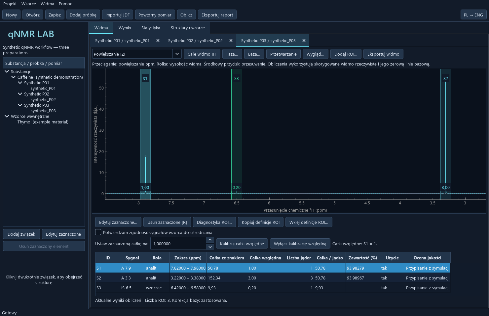
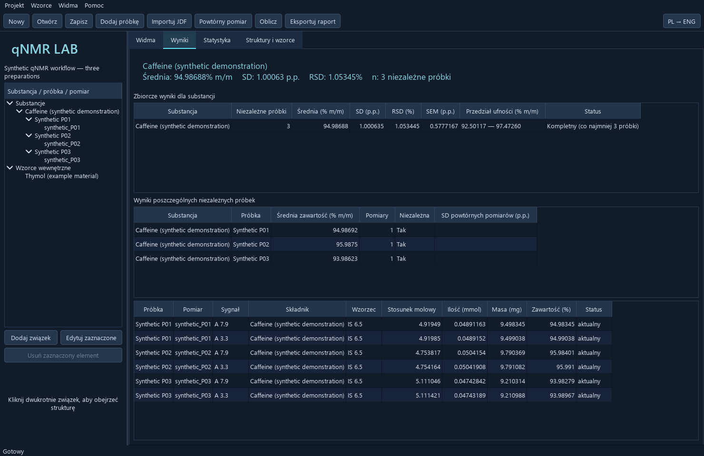
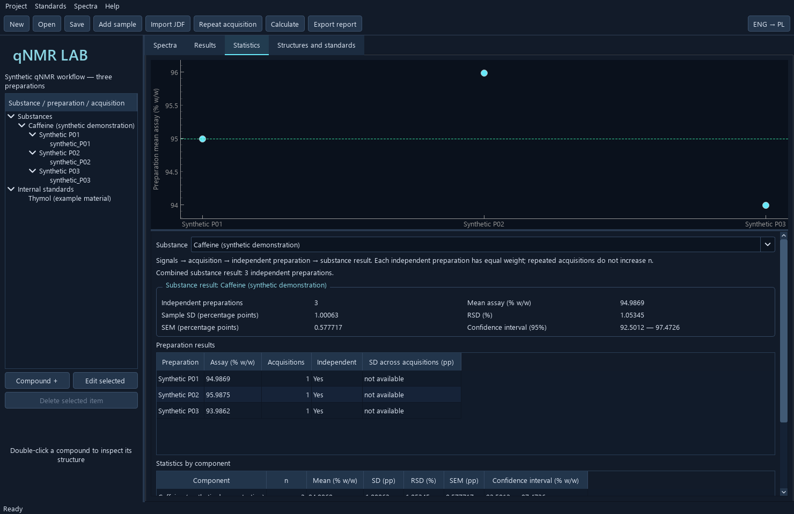

# qNMR Lab 1.0

Source version on `main`: **1.0.1**, with the redesigned scientific report
generator and optional extended technical profile. The latest tagged release
remains 1.0; run the source from `main` to use the new generator.
See [Scientific reports](docs/REPORTS_EN.md).

[Polski](README.md) · [Download release 1.0](https://github.com/Prospero1988/qNMR_Lab/releases/tag/v1.0) · [MIT](LICENSE)

A Windows desktop application for quantitative proton NMR with an internal
standard: process a JEOL FID, integrate signals, calculate substance results,
combine independent preparations and export reports. Polish is the default;
the **PL → ENG** button switches the interface and report language to English.



## Get started

Download `qNMR_Lab_1.0_PL_EN_deployment.rar` from [release 1.0](https://github.com/Prospero1988/qNMR_Lab/releases/tag/v1.0),
extract the complete folder and run **Start_qNMR_Lab.bat**.
Requires **Windows x64, CPython 3.12 x64 and Internet on the first run**.
The launcher creates a local environment with pinned dependencies and reuses it
on subsequent launches. DOSY Lab is not required. A Git clone works the same way.

```powershell
git clone https://github.com/Prospero1988/qNMR_Lab.git
cd qNMR_Lab
.\Start_qNMR_Lab.bat
```

## Features

- Conventional complex **JEOL JDF 1D ¹H** import; FFT, apodization, zero filling
  and live processing preview.
- Interactive phase, baseline-region selection and baseline correction;
  click-based ppm referencing.
- Signed integration, stable S1/S2/… IDs, relative integral calibration,
  interactive ROI editing/splitting and copy/paste.
- Structures from SMILES or MOL/SDF, molecular weights, atom indices and
  reference-material records.
- Copy processing from the preparation's first acquisition; manage and delete
  substances, preparations, acquisitions and reference materials.
- Spectrum color/width/grid preferences, PNG and CSV spectrum export.
- **DOCX, XLSX, CSV** reports and complete bundles with traceability.

## Substance → preparation → acquisition

Create at least three independently prepared samples per substance. Add repeat
acquisitions of the same physical solution to its existing preparation.
Signals are averaged within acquisitions, acquisitions within preparations,
then independent preparation means receive equal weights. Three preparations
with 2, 1 and 3 acquisitions give **n = 3**. Different substances are never pooled.



Statistics include mean, sample SD, RSD, SEM and a Student confidence interval.
Complete status requires at least three independent preparations with current
results. Input changes retain previous results as historical until recalculation.
Integral displays use two decimal places; calculations keep full precision.
Entered nuclei counts require no extra confirmation checkbox, and signal
exclusion reasons are optional.



## Portable projects

A **.qnmr** file embeds FIDs, processed spectra, parameters, ROIs, assignments,
masses, standards and results. Reopening and analysis do not require original
source files. **projects/** is the default project folder; **reports/** is the
default report export folder. Both ignore all content except `.gitkeep` in Git.

Spectrum shortcuts: **Z** zoom, **P** pan, **F** full spectrum, **I** draw an
integral, **R** remove, **M** modify boundaries and **D** split interactively.

## Documentation

- [User manual](docs/USER_MANUAL_EN.md) · [Installation/deployment](docs/DEPLOYMENT_EN.md)
- [Scientific methods](docs/SCIENTIFIC_METHODS_EN.md) · [Verification](docs/VALIDATION_EN.md)
- [Workbook comparison guide](docs/EXCEL_COMPARISON_EN.md) · [Developer guide](docs/DEVELOPER_GUIDE_EN.md)
- [Contributing](CONTRIBUTING.md) · [Changelog](CHANGELOG.md) · [Attribution](THIRD_PARTY.md)

Use **Project → Open synthetic example** for a complete three-preparation
analysis, also available as `examples/synthetic_three_samples.qnmr`.
The three accompanying synthetic JDFs exercise raw import. Screenshots show
simulated data. Private laboratory documents and real study files are not
distributed. Workbook import supports the documented layout; the private
comparison workbook is optional and is not included.

`.jjh5` and multidimensional JDF are unsupported. PDF export requires converting
the generated DOCX in another application. This software release is not a claim
of laboratory-method validation. The analyst evaluates acquisition conditions,
relaxation, chemical forms, nuclei counts and signal suitability. SD/SEM/CI are
not a complete measurement uncertainty budget.

Application code and documentation are **MIT**, copyright 2026 Prospero1988.
Conventional 1D processing derives from DOSY Lab; original notices and dependency
licenses are described in [THIRD_PARTY.md](THIRD_PARTY.md).
